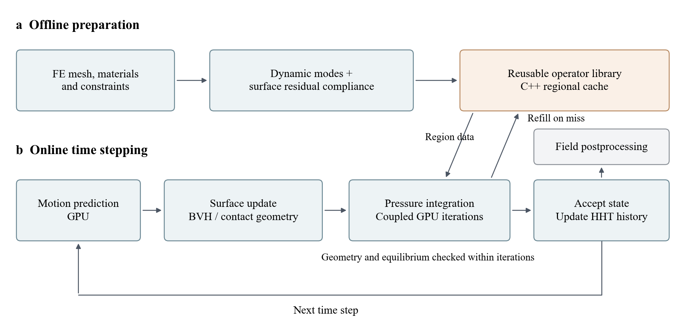
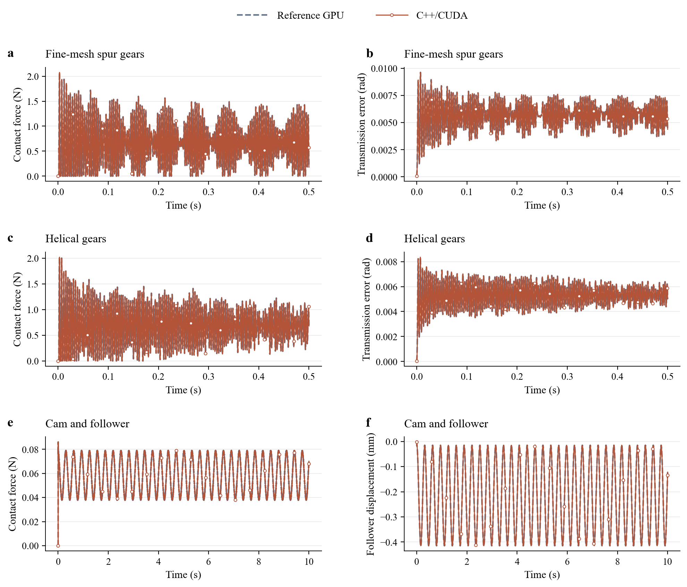

# CoFlexSim

**模态柔性体接触动力学的 C++/CUDA 求解框架。**

CoFlexSim 用动态模态描述整体运动，用表面残余柔度恢复接触引起的局部弹性响应。直齿轮、斜齿轮与凸轮共用同一后端，支持 CPU 参照、GPU 并行求解和应力应变后处理。

[算例与动画](#算例与动画) · [计算流程](#计算流程) · [结果与性能](#结果与性能) · [快速开始](#快速开始) · [参考文献](#参考文献)

## 算例与动画

以下动画和性能对应 v0.1.0 已完成的计算；斜齿轮与凸轮的[新网格及质量对比](docs/mesh_quality.md)已另行提供。

| 算例 | 节点 / 四面体 | 步长 | 仿真时长 |
|---|---:|---:|---:|
| 细网格直齿轮 | 67,586 / 235,504 | 125 μs | 0.5 s |
| 斜齿轮 | 9,796 / 24,642 | 125 μs | 0.5 s |
| 凸轮与从动件 | 468 / 1,176 | 500 μs | 10 s |

视频为 **60 fps MP4**，可直接播放。应力、应变采用整段固定色标，变形比例为 1。齿轮慢放 20 倍，凸轮原速播放。

### 直齿轮

<!-- VIDEO spur_fine_model_60fps.mp4 -->

<details>
<summary>应力与应变动画</summary>

von Mises 应力

<!-- VIDEO spur_fine_stress_60fps.mp4 -->

等效弹性应变

<!-- VIDEO spur_fine_strain_60fps.mp4 -->

</details>

[模型 MP4](https://github.com/W-Moorer/CoFlexSim/releases/download/v0.1.0/spur_fine_model_60fps.mp4) · [应力 MP4](https://github.com/W-Moorer/CoFlexSim/releases/download/v0.1.0/spur_fine_stress_60fps.mp4) · [应变 MP4](https://github.com/W-Moorer/CoFlexSim/releases/download/v0.1.0/spur_fine_strain_60fps.mp4)

### 斜齿轮

<!-- VIDEO helical_model_60fps.mp4 -->

<details>
<summary>应力与应变动画</summary>

von Mises 应力

<!-- VIDEO helical_stress_60fps.mp4 -->

等效弹性应变

<!-- VIDEO helical_strain_60fps.mp4 -->

</details>

[模型 MP4](https://github.com/W-Moorer/CoFlexSim/releases/download/v0.1.0/helical_model_60fps.mp4) · [应力 MP4](https://github.com/W-Moorer/CoFlexSim/releases/download/v0.1.0/helical_stress_60fps.mp4) · [应变 MP4](https://github.com/W-Moorer/CoFlexSim/releases/download/v0.1.0/helical_strain_60fps.mp4)

### 凸轮与从动件

<!-- VIDEO guided_cam_model_60fps.mp4 -->

<details>
<summary>应力与应变动画</summary>

von Mises 应力

<!-- VIDEO guided_cam_stress_60fps.mp4 -->

等效弹性应变

<!-- VIDEO guided_cam_strain_60fps.mp4 -->

</details>

[模型 MP4](https://github.com/W-Moorer/CoFlexSim/releases/download/v0.1.0/guided_cam_model_60fps.mp4) · [应力 MP4](https://github.com/W-Moorer/CoFlexSim/releases/download/v0.1.0/guided_cam_stress_60fps.mp4) · [应变 MP4](https://github.com/W-Moorer/CoFlexSim/releases/download/v0.1.0/guided_cam_strain_60fps.mp4)

[网格质量与更新](docs/mesh_quality.md) · [模型参数](examples/README.md) · [场量定义](docs/media.md)

## 计算流程



离线构造模态与整件表面残余柔度；在线由 C++ 管理时间推进和区域缓存，GPU 完成表面更新、BVH 查询、接触积分与耦合求解。应力应变在后处理恢复。

[算法与代码结构](docs/architecture.md)

## 结果与性能

相同模型、步长下，统一 C++/CUDA 后端与参考 GPU 流程的长时程响应如下。



[末段响应图](docs/assets/response_late.png) · [完整响应 CSV 与误差定义](results/README.md)

### 在线时间

RTX 3070，单位秒。短窗各跑三次，报告中位数；预计算与初始化单列。

| 算例 / 短窗 | CPU | 原 GPU | 优化 GPU | C++/CUDA | 相对原 GPU |
|---|---:|---:|---:|---:|---:|
| 直齿轮 / 200–212 ms | — | 4.381 | — | **3.115** | **1.41×** |
| 斜齿轮 / 0–12 ms | 96.009 | 2.867 | 1.952 | **1.451** | **1.98×** |
| 凸轮 / 0–330 ms | 55.168 | 3.036 | 2.284 | **1.852** | **1.64×** |

长时程的完整测量记录：

| 算例 / 平台 | 参考 GPU / s | C++/CUDA / s | 比值 |
|---|---:|---:|---:|
| 直齿轮 0.5 s / 3070，首轮 | 506.922 | 194.745 | 2.60× |
| 直齿轮 0.5 s / 3070，复测 | 173.795 | 138.783 | 1.25× |
| 斜齿轮 0.5 s / 3070，首轮 | 68.847 | 77.461 | 0.89× |
| 斜齿轮 0.5 s / 3070，复测 | 63.585 | 54.564 | 1.17× |
| 凸轮 10 s / 3070 | 60.118 | 54.589 | 1.10× |
| 斜齿轮 0.5 s / 3090 | 43.655 | 42.053 | 1.04× |
| 凸轮 10 s / 3090 | 49.979 | 48.842 | 1.02× |

长程为单次实测值，保留首轮和复测以呈现读盘缓存与运行顺序的影响。参考后端、硬件配置和预计算时间见 [性能记录](docs/performance.md)。

### 内存

单位 MiB，来自独立内存诊断。

| 算例 | 参考显存 | C++/CUDA 显存 | 参考主机 RSS | C++/CUDA 主机 RSS |
|---|---:|---:|---:|---:|
| 直齿轮 | 1,364.3 | 2,079.0 | 2,150.5 | 2,169.2 |
| 斜齿轮 | 870.6 | 870.7 | 2,111.8 | 2,106.3 |
| 凸轮 | 88.8 | 63.8 | 643.3 | 651.7 |

## 快速开始

环境：NVIDIA GPU、CUDA Toolkit ≥ 12.6、C++17、CMake ≥ 3.22、Python 3.12。

```bash
git clone https://github.com/W-Moorer/CoFlexSim.git
cd CoFlexSim
python -m pip install -r requirements.txt
python coflex.py build
python coflex.py check
python coflex.py fetch-data
python coflex.py prepare cam
python coflex.py run cam --backend native_cuda
```

使用 `--full` 运行完整轨迹；`--backend cpu_columns` 或 `host_cuda` 切换参照后端。Windows 从 Visual Studio x64 开发者终端构建。

[详细复现步骤](examples/README.md) · [架构](docs/architecture.md) · [许可证](LICENSE)

## 参考文献

1. Yao J-L, Shu X-B, Ren G-X. A free-interface component mode synthesis of moving contact multibodies and its application to gear contacts[J]. International Journal for Numerical Methods in Engineering, 2022, 123(14): 3317–3343. DOI: [10.1002/nme.6970](https://doi.org/10.1002/nme.6970). [PDF](https://github.com/W-Moorer/CoFlexSim/releases/download/v0.1.0/Yao-2022-Free-interface-CMS-moving-contact.pdf)

2. Tian Z, Yao J, Fan W, Zhou P, Liu Y, Lei S, Ren H. A parallel and memory-aware free-interface component mode synthesis framework for industrial-scale moving contact simulation[J]. Advances in Engineering Software, 2026, 222: 104278. DOI: [10.1016/j.advengsoft.2026.104278](https://doi.org/10.1016/j.advengsoft.2026.104278). [PDF](https://github.com/W-Moorer/CoFlexSim/releases/download/v0.1.0/Tian-2026-Parallel-memory-aware-CMS.pdf)

3. Mi J, Ren H. A convex optimization method for contact dynamics between flexible bodies with surface parameterization and residual compliance[J]. Applied Mathematical Modelling, 2027, 162: 117206. DOI: [10.1016/j.apm.2026.117206](https://doi.org/10.1016/j.apm.2026.117206). [PDF](https://github.com/W-Moorer/CoFlexSim/releases/download/v0.1.0/Mi-2027-Parameterized-residual-compliance.pdf)

[BibTeX](references/references.bib)
