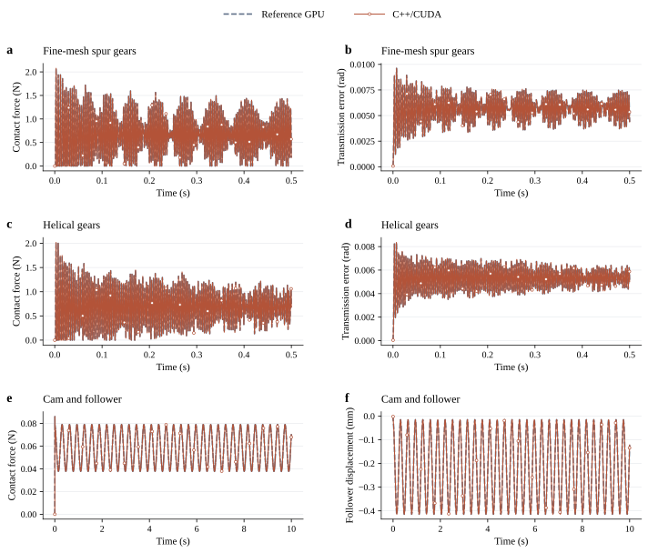
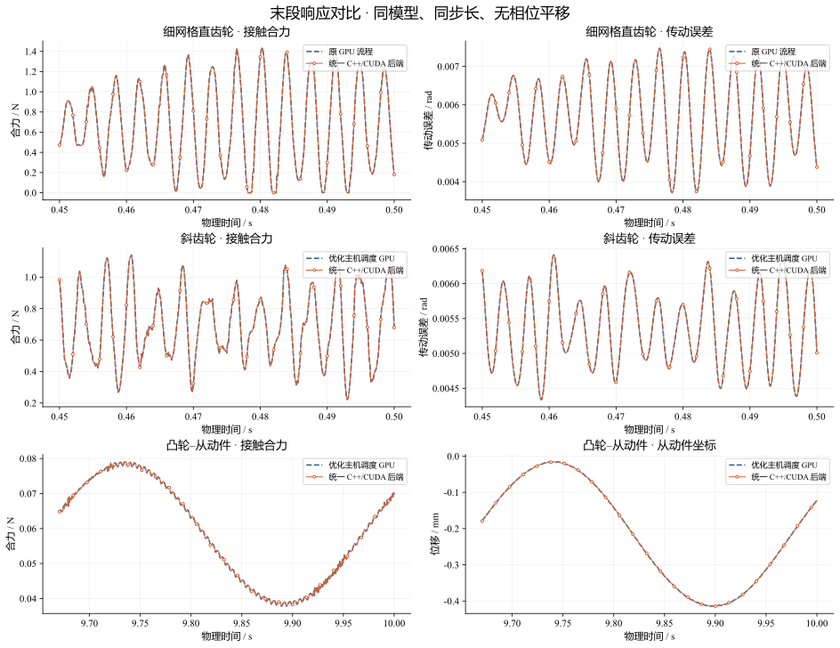
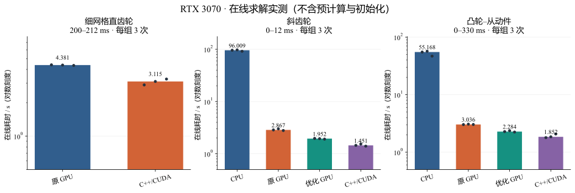
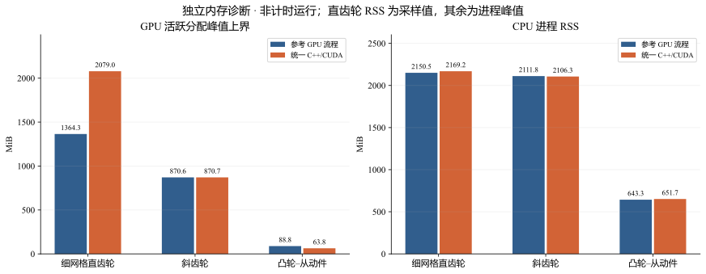

# CoFlexSim

**面向模态柔性体接触动力学的统一 C++/CUDA 在线求解框架。**

CoFlexSim 将少量动态模态与整体结构的表面残余柔度耦合，用统一接触流程计算直齿轮、斜齿轮和凸轮–从动件的运动与传力。Python 负责模型初始化、离线准备和后处理；C++ 管理在线时间推进与区域数据供给；CUDA 执行几何查询、压力积分、耦合求解和状态验收。

[快速运行](#快速运行) · [三个算例](#三个算例) · [响应曲线](#响应曲线) · [时间开销](#时间开销) · [内存对比](#内存对比) · [动画下载](#动画下载) · [架构说明](docs/architecture.md)


## 仓库内容

- 完整的统一求解依赖：有限元算子准备、模态／残余柔度、CPU 参照路径、GPU 几何与接触求解、C++ 区域缓存及时间调度。
- 同一个 `coflex.py` 入口，通过配置选择 `cpu_columns`、`host_cuda` 或 `native_cuda`，算例几何不决定求解器实现。
- 三个真实模型的输入、细网格直齿轮预计算模态算子、长时程响应 CSV、测量记录、可复现绘图脚本。
- 9 个 **60 fps MP4**：每例均包含整体模型、von Mises 应力和等效偏应变动画。

本版保留已验收的数值流程。完整残余柔度库存于主机内存或磁盘，当前区域通过有限大小的缓存进入显存；尚非全部柔度常驻 GPU 的方案。在线耗时计入区域查询、读入、传输与重试，单次矩阵查询时间不等于完整求解时间。

## 三个算例

节点和单元数量为整套机构合计。

| 算例 | 节点 | 四面体 | 时间步 | 长时程 | 动态模态数 |
|---|---:|---:|---:|---:|---:|
| 细网格直齿轮 `spur` | 67,586 | 235,504 | 125 μs | 0.5 s / 4,000 步 | 112 + 225 |
| 斜齿轮 `helical` | 9,796 | 24,642 | 125 μs | 0.5 s / 4,000 步 | 333 + 499 |
| 凸轮–从动件 `cam` | 468 | 1,176 | 500 μs | 10 s / 20,000 步 | 1 + 0 |

模型采用小弹性变形、有限参考运动和无摩擦法向接触。齿轮内孔与参考点耦合，凸轮从动件沿指定方向运动。动态模态负责惯性响应，残余柔度保留截断方向的准静态接触响应及跨区域耦合。详见 [模型与复现说明](examples/README.md)。

## 响应曲线

下面比较**相同模型、相同步长的原／优化 GPU 流程与统一 C++/CUDA 后端**。全程使用原始时间轴，没有平移相位或拟合幅值；曲线接近重合，稀疏圆标记用于辨认新后端。





| 长时程一致性 | 接触力相对 L2 差异 | 传动误差／从动件位移相对 L2 差异 |
|---|---:|---:|
| 细网格直齿轮 0.5 s | 7.12 × 10⁻¹⁰ | 2.34 × 10⁻¹⁰ |
| 斜齿轮 0.5 s，首次配对 | 4.21 × 10⁻¹⁰ | 8.85 × 10⁻¹¹ |
| 凸轮 10 s | 6.41 × 10⁻¹³ | 1.72 × 10⁻¹⁴ |

这些数字验证的是**后端迁移的一致性**，不代表相对于独立 FEM 的工程误差，也不是空间／时间离散误差。当前发布未新增 Abaqus 验证。误差定义、完整测量记录和原始记录 SHA-256 见 [结果说明](results/README.md)。

## 时间开销

主要平台：**RTX 3070 8 GiB、Ryzen 9 5900X、32 GiB RAM、Windows 11、CUDA 12.6、Python 3.12.7、CuPy 13.6**。CPU 参照为当前单线程实现；测试在共享桌面环境顺序运行。

### 三次短窗测量

单位为秒，均为三次中位数。预计算、输入加载、初始化、图像／视频输出不计入在线求解。

| 算例与时间区间 | 当前 CPU | 原 GPU | 优化主机调度 GPU | C++/CUDA | 相对原 GPU |
|---|---:|---:|---:|---:|---:|
| 直齿轮 200–212 ms | — | 4.381 | — | **3.115** | **1.41×** |
| 斜齿轮 0–12 ms | 96.009 | 2.867 | 1.952 | **1.451** | **1.98×** |
| 凸轮 0–330 ms | 55.168 | 3.036 | 2.284 | **1.852** | **1.64×** |

斜齿轮和凸轮相对当前 CPU 实现分别为 66.17×、29.78×。这是对本仓库 CPU 实现的加速，不能推广为相对最优 CPU 算法或商业 FEM 的加速。细网格直齿轮 CPU 仅测了 1 ms 短前缀，不外推到 12 ms 或 0.5 s。



凸轮 CPU／原 GPU 数据来自上一轮相同模型、步长的测量，优化 GPU／原生后端来自最终轮；各轮来源完整保留。

### 长时程测量

以下是**实际单次观察值，不是三次长程中位数**。原始和追加测量均列出，避免把读盘缓存、运行次序的影响当作稳定收益。

| 算例 | 平台／测量 | 参照 GPU 在线 / s | C++/CUDA 在线 / s | 比值 |
|---|---|---:|---:|---:|
| 直齿轮 0.5 s | 3070，首次 | 506.922 | 194.745 | 2.60× |
| 直齿轮 0.5 s | 3070，追加 | 173.795 | **138.783** | 1.25× |
| 斜齿轮 0.5 s | 3070，首次 | 68.847 | 77.461 | 0.89× |
| 斜齿轮 0.5 s | 3070，交换顺序复测 | 63.585 | **54.564** | 1.17× |
| 凸轮 10 s | 3070 | 60.118 | **54.589** | 1.10× |
| 斜齿轮 0.5 s | 3090 | 43.655 | **42.053** | 1.04× |
| 凸轮 10 s | 3090 | 49.979 | **48.842** | 1.02× |

直齿轮参照为原 GPU 流程；斜齿轮／凸轮参照为已优化主机调度 GPU。直齿轮库位于 SATA HDD，未清空或锁定 OS 缓存。3090 平台为 Linux、i7-14700K、CUDA 12.8，因此跨平台数值不能解释为单纯显卡型号提升。RTX 4090 的 `sm_89` 编译目标已提供，尚无 4090 实机验收数据。

### 预计算与在线分开

| 算例 | 模态／算子准备 | 柔度库与保守边界准备 | 在线报告方式 |
|---|---:|---:|---|
| 细网格直齿轮 | 复用已有数据 | 复用约 9.46 GiB 离线库 | 追加原生测量：加载 40.407 s；小算子 4.959 s；初始化 37.088 s；在线 138.783 s；检查点 I/O 12.912 s |
| 斜齿轮 | 57.607 s | 84.445 s | 每次加载／初始化另列 |
| 凸轮 | 1.782 s | 0.070 s | 每次加载／初始化另列 |

准备时间来自对应历史测量；发布入口采用可恢复的文件库，首次本地准备耗时以本机记录为准。复用旧数据不等于预计算成本为零。

## 内存对比

单位 MiB。GPU 数值为独立短窗诊断中的活跃分配峰值加原生工作区上界，不包含其他程序、CUDA 上下文和未使用的池预留。

| 算例 | 参考 GPU 显存 | C++/CUDA 显存 | 参考主机 RSS | C++/CUDA 主机 RSS |
|---|---:|---:|---:|---:|
| 细网格直齿轮 | 1,364.3 | 2,079.0 | 2,150.5 | 2,169.2 |
| 斜齿轮 | 870.6 | 870.7 | 2,111.8 | 2,106.3 |
| 凸轮 | 88.8 | 63.8 | 643.3 | 651.7 |

直齿轮 RSS 是采样值，另外两例为进程峰值；参考流程与上一表相同。本版直齿轮通过预留容量减少在线重建，显存增加；凸轮显存下降，斜齿轮基本持平。



## 快速运行

建议先运行最小的凸轮算例。需要 NVIDIA GPU、兼容 CUDA 12.6 的驱动、CUDA Toolkit ≥ 12.6、CMake ≥ 3.22、C++17 编译器和 Python 3.12。Windows 在 Visual Studio x64 开发者终端执行；Linux 使用 GCC/G++ 与 OpenMP。

```bash
git clone https://github.com/W-Moorer/CoFlexSim.git
cd CoFlexSim
python -m venv .venv
# Windows: .venv\Scripts\activate
# Linux:   source .venv/bin/activate
python -m pip install -r requirements.txt
python coflex.py build
python coflex.py check
python coflex.py fetch-data
python coflex.py prepare cam
python coflex.py run cam --backend native_cuda
```

`build` 下载并核验 Eigen 3.4.0；也可用 `--eigen-root /path/to/eigen-3.4.0`。`fetch-data` 下载三个网格及细网格模态算子并核验 SHA-256。临时文件、缓存、数据和输出默认放在项目目录中，请选择空间充足的盘。

```bash
# 相同模型的 CPU / 优化 GPU 对照
python coflex.py run cam --backend cpu_columns --output outputs/cam_cpu.json
python coflex.py run cam --backend host_cuda --output outputs/cam_host.json
# 10 s 完整轨迹
python coflex.py run cam --full --output outputs/cam_native_10s.json
# 斜齿轮 0.5 s
python coflex.py prepare helical
python coflex.py run helical --full --output outputs/helical_native_05s.json
# 最新细网格直齿轮；离线库需约 9.46 GiB 磁盘
python coflex.py prepare spur --bank-budget-gib 12
python coflex.py run spur --full --output outputs/spur_native_05s.json
# 200–212 ms 换齿短窗
python coflex.py run spur --restart gpu-contact/data/spur/short_window_state.npz --steps 96 --output outputs/spur_window.json
# 内存仪器单独运行
python coflex.py run cam --memory --output outputs/cam_memory.json
```

正式重复使用新进程和不同 `--output`，已有结果不覆盖。第一次初始化包含 JIT 开销，在线计时从初始化完成后开始。详见 [复现说明](examples/README.md)。

## 动画下载

每段 600 帧，60 fps，1280×720，H.264 MP4。齿轮 0.5 s 物理过程以 20 倍慢放显示为 10 s；凸轮 10 s 为原速。场量使用整段固定色标、真实变形比例，Latin 文字为 Times New Roman。

| 算例 | 整体模型 | 应力 | 应变 |
|---|---|---|---|
| 最新细网格直齿轮 | [MP4](https://github.com/W-Moorer/CoFlexSim/releases/download/v0.1.0/spur_fine_model_60fps.mp4) | [MP4](https://github.com/W-Moorer/CoFlexSim/releases/download/v0.1.0/spur_fine_stress_60fps.mp4) | [MP4](https://github.com/W-Moorer/CoFlexSim/releases/download/v0.1.0/spur_fine_strain_60fps.mp4) |
| 斜齿轮 | [MP4](https://github.com/W-Moorer/CoFlexSim/releases/download/v0.1.0/helical_model_60fps.mp4) | [MP4](https://github.com/W-Moorer/CoFlexSim/releases/download/v0.1.0/helical_stress_60fps.mp4) | [MP4](https://github.com/W-Moorer/CoFlexSim/releases/download/v0.1.0/helical_strain_60fps.mp4) |
| 凸轮–从动件 | [MP4](https://github.com/W-Moorer/CoFlexSim/releases/download/v0.1.0/guided_cam_model_60fps.mp4) | [MP4](https://github.com/W-Moorer/CoFlexSim/releases/download/v0.1.0/guided_cam_stress_60fps.mp4) | [MP4](https://github.com/W-Moorer/CoFlexSim/releases/download/v0.1.0/guided_cam_strain_60fps.mp4) |

[下载全部动画、海报和元数据](https://github.com/W-Moorer/CoFlexSim/releases/download/v0.1.0/CoFlexSim-media-60fps.zip)。场量后处理不包含在在线计时里。详见 [动画口径](docs/media.md)。

## 目录与维护

```text
coflex.py                     统一命令入口
gpu-contact/native/           C++ 调度、区域库读取、CUDA 数据供给
gpu-contact/mechanics/        有限元与接触 C++ 扩展
gpu-contact/src/              数值流程、CUDA 核、Python 初始化适配
examples/                     三个算例配置与数据校验清单
results/                      完整响应 CSV、计时／内存及来源记录
tools/plot_results.py          Python 图形重生成
docs/                         架构、运行口径与媒体说明
provenance/                    研究快照与发布代码对应记录
```

修改求解器后同步更新配置、来源和一致性结果；修改性能数字时保留重复测量、机器环境、预计算口径及不利结果。大网格、动画、离线库和缓存不进入 Git 历史。

本发布已在独立目录重新编译，并完成三个算例的 GPU 短窗核验及凸轮 CPU/GPU 对照，见 [发布验收记录](provenance/release_validation.json)。这些检查不替代或重新标记既有长程性能测量。

许可证：[Apache-2.0](LICENSE)。依赖见 [THIRD_PARTY.md](THIRD_PARTY.md)。目前没有与本发布对应的正式论文 DOI；引用可使用版本号与提交哈希。
