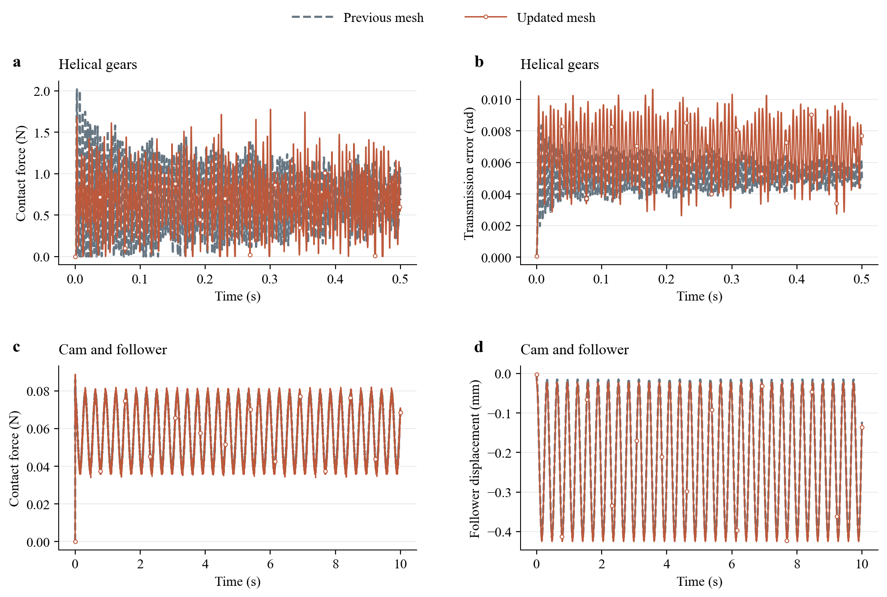

# CoFlexSim

**模态柔性体接触动力学的 C++/CUDA 求解框架。**

CoFlexSim 用动态模态描述整体运动，用表面残余柔度恢复接触引起的局部弹性响应。三个算例共用同一后端，应力和应变由接受状态在后处理恢复。

[算例与动画](#算例与动画) · [计算流程](#计算流程) · [结果与性能](#结果与性能) · [快速开始](#快速开始) · [参考文献](#参考文献)

## 算例与动画

斜齿轮和凸轮已采用重划网格完成长时程计算。直齿轮沿用已验证的细网格。

| 算例 | 节点 / 四面体 | 步长 | 仿真时长 |
|---|---:|---:|---:|
| 细网格直齿轮 | 67,586 / 235,504 | 125 μs | 0.5 s |
| 斜齿轮 | 38,556 / 136,056 | 125 μs | 0.5 s |
| 凸轮与从动件 | 813 / 2,788 | 500 μs | 10 s |

九段视频均为 **60 fps MP4**。应力、应变视频采用接触区特写，附整体位置小图与固定色标；实际变形比例为 1。齿轮慢放 20 倍，凸轮原速播放。

### 直齿轮

https://github.com/user-attachments/assets/e352b887-6998-4f59-9300-eaaf37fd35ed

<details>
<summary>接触区应力与应变特写</summary>

von Mises 应力

https://github.com/user-attachments/assets/3c3c274f-db20-4c23-a787-f77082b53318

等效弹性应变

https://github.com/user-attachments/assets/6580145b-2f0c-492a-b8c9-a96e89282adc

</details>

[模型 MP4](https://github.com/W-Moorer/CoFlexSim/releases/download/v0.2.0/spur_fine_model_60fps.mp4) · [应力 MP4](https://github.com/W-Moorer/CoFlexSim/releases/download/v0.2.0/spur_fine_stress_60fps.mp4) · [应变 MP4](https://github.com/W-Moorer/CoFlexSim/releases/download/v0.2.0/spur_fine_strain_60fps.mp4)

### 斜齿轮

https://github.com/user-attachments/assets/2b402778-3414-4868-b47e-f87353ad60ca

<details>
<summary>接触区应力与应变特写</summary>

von Mises 应力

https://github.com/user-attachments/assets/544ce426-9fbb-477c-9f26-43639b069859

等效弹性应变

https://github.com/user-attachments/assets/bc757a4d-cf80-4e24-b7cc-50cd7657b3f8

</details>

[模型 MP4](https://github.com/W-Moorer/CoFlexSim/releases/download/v0.2.0/helical_model_60fps.mp4) · [应力 MP4](https://github.com/W-Moorer/CoFlexSim/releases/download/v0.2.0/helical_stress_60fps.mp4) · [应变 MP4](https://github.com/W-Moorer/CoFlexSim/releases/download/v0.2.0/helical_strain_60fps.mp4)

### 凸轮与从动件

https://github.com/user-attachments/assets/d44fef94-2eee-466b-80e9-fea3436865de

<details>
<summary>接触区应力与应变特写</summary>

von Mises 应力

https://github.com/user-attachments/assets/5ed22b72-30e9-44fb-9f31-fb986c75664a

等效弹性应变

https://github.com/user-attachments/assets/6711241e-cf2c-4eaa-a990-cbcf5e49ff31

</details>

[模型 MP4](https://github.com/W-Moorer/CoFlexSim/releases/download/v0.2.0/cam_model_60fps.mp4) · [应力 MP4](https://github.com/W-Moorer/CoFlexSim/releases/download/v0.2.0/cam_stress_60fps.mp4) · [应变 MP4](https://github.com/W-Moorer/CoFlexSim/releases/download/v0.2.0/cam_strain_60fps.mp4)

[网格质量对比](docs/mesh_quality.md) · [模型参数与复现](examples/README.md) · [场量与色标](docs/media.md)

## 计算流程


离线构造模态与整件表面残余柔度；在线由 C++ 管理时间推进和区域缓存，GPU 完成表面更新、BVH 查询、接触积分与耦合求解。

## 结果与性能

新旧网格采用相同材料、载荷、步长和 C++/CUDA 后端，完整响应对比如下。



[末段对比](docs/assets/mesh_response_late.png) · [细网格直齿轮响应](docs/assets/spur_response.png) · [CSV 与测量数据](results/mesh_update)

新旧网格的全程接触力／运动响应差：凸轮 **2.85%／3.09%**，斜齿轮 **71.48%／46.40%**。斜齿轮对空间离散仍明显敏感，不能仅凭网格质量改善就认定响应精度已提高；[几何核查与结果说明](docs/remeshed_results.md)保留这一变化。

### 在线时间

RTX 3070；单位为秒。以下长时程为单次完整测量，预计算、初始化和场量导出分开记录。

| 算例 | 仿真时长 | 在线求解 | 初始化 | 离线准备总计 |
|---|---:|---:|---:|---:|
| 细网格直齿轮 | 0.5 s | 138.783 | 沿用已有测量 | 复用已有数据 |
| 新网格斜齿轮 | 0.5 s | 105.794 | 6.801 | 2670.591 |
| 新网格凸轮 | 10 s | 58.734 | 0.298 | 1.286 |

新网格短窗各跑三次，报告中位数：

| 算例 / 短窗 | 参考 GPU | C++/CUDA | 加速比 |
|---|---:|---:|---:|
| 斜齿轮 / 0–12 ms | 3.005 | 2.493 | 1.21× |
| 凸轮 / 0–330 ms | 2.055 | 1.926 | 1.07× |

### 存储

| 算例 | 主机表面柔度库 / MiB | GPU 活跃分配诊断上界 / MiB |
|---|---:|---:|
| 细网格直齿轮 | 约 9,687（磁盘分块库） | 2,079.0 |
| 新网格斜齿轮 | 5,158.9（RAM 库） | 1,373.1 |
| 新网格凸轮 | 2.4（RAM 库） | 65.8 |

新网格显存来自独立 64 步诊断，包含原生工作区；预计算使用主机内存。直齿轮沿用此前同网格测量。[完整测量与误差](docs/remeshed_results.md) · [v0.1.0 性能记录](docs/performance.md)

## 快速开始

环境：NVIDIA GPU、CUDA Toolkit ≥ 12.6、C++17、CMake ≥ 3.22、Python 3.12。

```bash
git clone https://github.com/W-Moorer/CoFlexSim.git
cd CoFlexSim
python -m pip install -r requirements.txt
python coflex.py build
python coflex.py check
python coflex.py fetch-data
python coflex.py prepare cam
python coflex.py run cam --backend native_cuda --full
```

Windows 从 Visual Studio x64 开发者终端构建。新网格的准备目录按网格哈希隔离；旧算子的完整记录保留在原目录。

[详细复现步骤](examples/README.md) · [算法与代码结构](docs/architecture.md) · [许可证](LICENSE)

## 参考文献

1. Yao J-L, Shu X-B, Ren G-X. A free-interface component mode synthesis of moving contact multibodies and its application to gear contacts[J]. International Journal for Numerical Methods in Engineering, 2022, 123(14): 3317–3343. DOI: [10.1002/nme.6970](https://doi.org/10.1002/nme.6970). [PDF](https://github.com/W-Moorer/CoFlexSim/releases/download/v0.1.0/Yao-2022-Free-interface-CMS-moving-contact.pdf)

2. Tian Z, Yao J, Fan W, Zhou P, Liu Y, Lei S, Ren H. A parallel and memory-aware free-interface component mode synthesis framework for industrial-scale moving contact simulation[J]. Advances in Engineering Software, 2026, 222: 104278. DOI: [10.1016/j.advengsoft.2026.104278](https://doi.org/10.1016/j.advengsoft.2026.104278). [PDF](https://github.com/W-Moorer/CoFlexSim/releases/download/v0.1.0/Tian-2026-Parallel-memory-aware-CMS.pdf)

3. Mi J, Ren H. A convex optimization method for contact dynamics between flexible bodies with surface parameterization and residual compliance[J]. Applied Mathematical Modelling, 2027, 162: 117206. DOI: [10.1016/j.apm.2026.117206](https://doi.org/10.1016/j.apm.2026.117206). [PDF](https://github.com/W-Moorer/CoFlexSim/releases/download/v0.1.0/Mi-2027-Parameterized-residual-compliance.pdf)

[BibTeX](references/references.bib)
