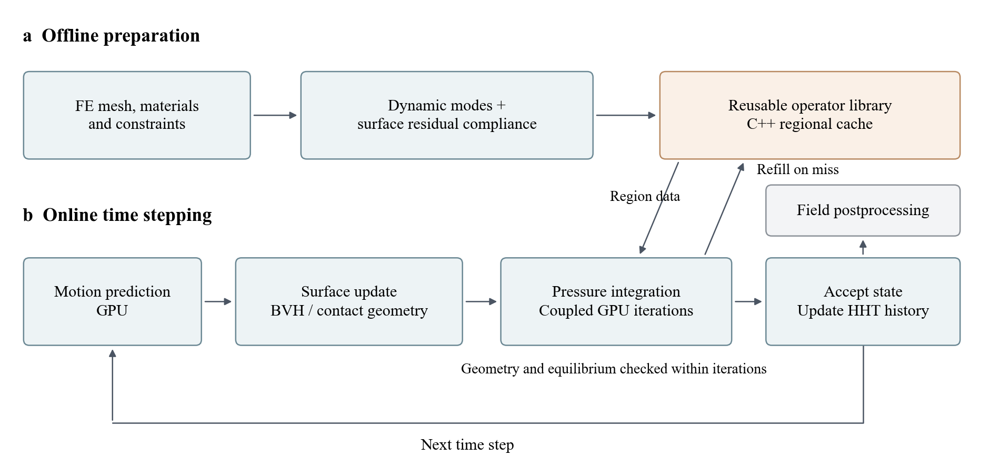

# 统一后端与数值流程

三个执行路径由 `common_contact_backend.create_backend` 创建。公开入口采用已验收的 `CARTESIAN_CONTRACT`：相同 HHT 时间离散、笛卡尔惯性投影、压力支撑与有限法向柔度接触。源码保留其他研究模块不意味着公开入口切换了物理模型。

## 离线算子

从整件有限元刚度 K、质量 M 和约束出发选定模态 Φ，指定表面残余响应为：

```text
R = S K⁻¹ Sᵀ − (S Φ) (Φᵀ K Φ)⁻¹ (S Φ)ᵀ
```

S 只提取指定接触面。R 保留整件结构及跨区域耦合，不是局部子刚度的逆。刚体参考运动、模态质量与惯性耦合另行保留。直齿轮复用高阶模态库，再用低秩 Schur 修正映射到 112 + 225 动态坐标。斜齿轮、凸轮按相同静态尾部惯性判据离线选模。

## 在线执行



CPU 负责区域数据供给，GPU 执行内层迭代。正常路径预留容量，并检查候选覆盖与工作区容量。

| 层次 | 主要代码 |
|---|---|
| 入口与准备 | `coflex.py`、`public_runtime.py` |
| 工厂与契约 | `common_contact_backend.py`、`selected_contact_backend.py` |
| 时间离散与惯性 | `pd_time_integration.py`、`projected_cartesian_inertia.py` |
| 残余响应 | `host_surface_library.py`、`selected_residual_region.py` |
| C++ 调度／供给 | `native/src/scheduler.cpp`、`native/src/region.cpp` |
| GPU 几何／求解 | `src/*.cu`、`streamed_region_backend.py` |
| 条件图 | `device_graph.cu`、`trajectory_graph.cu`、`portable_graph.py` |
| FE 与接触扩展 | `mechanics/native.cpp`、`mechanics/mortar_consistent_native.cpp` |

本版验证了无摩擦、小弹性变形、指定转轴／移动方向的三个机构。3070、3090 已运行；4090 为编译目标，待实机验证。数值核与研究快照对应关系见 `provenance/source_snapshot.json`。
