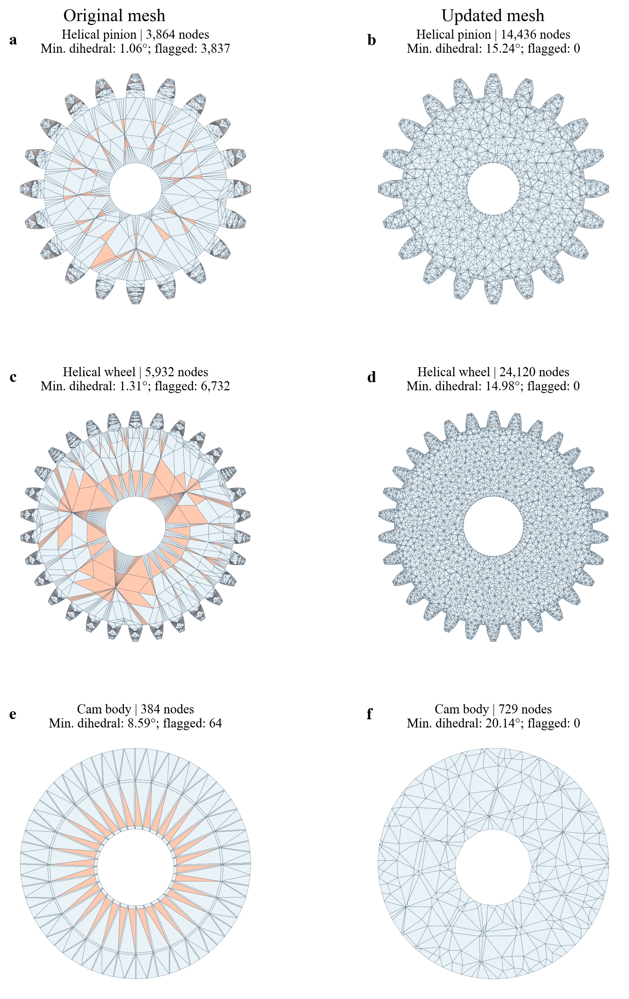

# 网格质量与更新

已检查直齿轮以外的两个算例，并重划斜齿轮两件和凸轮本体。凸轮从动件通过质量检查，保留原网格。

图中为实际四面体截面；橙色为触发质量检查的单元。检查采用最小二面角 < 10°、最大二面角 > 160° 或归一化体积／外接球形状值 < 0.02。新网格均为正体积，闭合边界及内部面连接检查通过。

| 零件 | 原节点 → 新节点 | 原四面体 → 新四面体 | 最小二面角 | 质量标记单元 |
|---|---:|---:|---:|---:|
| 斜齿轮 1 | 3,864 → 14,436 | 9,828 → 50,237 | 1.06° → 15.24° | 3,837 → 0 |
| 斜齿轮 2 | 5,932 → 24,120 | 14,814 → 85,819 | 1.31° → 14.98° | 6,732 → 0 |
| 凸轮 1 | 384 → 729 | 960 → 2,572 | 8.59° → 20.14° | 64 → 0 |
| 凸轮 2 | 84 → 84 | 216 → 216 | 33.69° → 33.69° | 0 → 0 |

斜齿轮原网格将很短的齿廓边沿齿宽分三层扫掠，产生大量扁长单元。更新采用平滑齿廓、三维四面体剖分和内部节点优化。凸轮改用圆盘／内孔 CAD 体剖分，消除原径向扇区中的小二面角。

设计尺寸、材料、载荷、参考运动约束和时间步保持原值；新表面离散使体积变化分别为 −0.0447%、−0.00109% 和 +0.0693%。

## 更新输入

[下载两组新网格](https://github.com/W-Moorer/CoFlexSim/releases/download/v0.1.0/coflexsim-quality-meshes-20261112.zip) · [逐件质量记录](../examples/mesh_updates/quality.json) · [SHA-256](../examples/mesh_updates/manifest.json)

v0.2.0 将这两组输入设为默认算例，重新构造模态与残余柔度，并完成斜齿轮 0.5 s、凸轮 10 s 的长时程计算。[新旧网格响应、耗时和后端核验](remeshed_results.md)与 README 的动画均对应更新后的网格。旧网格结果保留在 v0.1.0，便于追溯。
