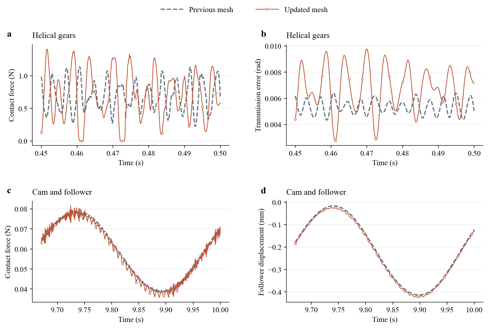

# 新网格计算结果

两例均从原始初态运行，材料、载荷、HHT 步长及接触处理保持不变。直齿轮继续使用此前细网格；本轮为它重新恢复场量、导出接触特写。

## 完整覆盖与新旧网格差异

相对差采用同一物理时刻的 L2 范数，以旧网格响应范数归一化；没有平移或拟合曲线。这里衡量空间离散更新带来的变化，独立 Abaqus 参照沿用历史工作，本轮没有新增商业软件计算。

| 算例 | 时长 / 步数 | 全程力差 | 全程运动响应差 | 末段力差 | 末段运动响应差 |
|---|---:|---:|---:|---:|---:|
| 斜齿轮 | 0.5 s / 4,000 | 71.476% | 46.402% | 70.761% | 44.098% |
| 凸轮 | 10 s / 20,000 | 2.852% | 3.091% | 2.704% | 3.117% |

运动响应分别是 `theta1 + (20/30) theta0` 和从动件位移；末段分别为最后 50 ms 和 330 ms。

## 斜齿轮变化的解释边界

材料、载荷、参考运动、初态和步长逐项相同。同一新网格下，三次短窗的两种 GPU 流程相对差约为 2.46e-13，因此这里的大差异不是这两种实现之间的数值偏差。

弹性频谱也发生了明显变化：齿轮 1 的最低固有频率从 487.43 Hz 变为 355.78 Hz，齿轮 2 从 355.26 Hz 变为 188.63 Hz；同一 11,127.66 Hz 保留频带内的模态数由 333＋499 变为 446＋903。这证明更新影响了有限元模型的弹性响应，并不只是动画表面变得更光滑。

重划网格同时改变了齿面三角片位置、法向和接触积分支撑。新齿面节点到旧接触三角片的最近距离 P95 为 79.77／84.23 μm，其中法向投影 P95 为 4.82／3.04 μm。约束面节点数从 160／240 增至 360／540。整段接触合力模长的时间积分只变化约 0.074%，但瞬时峰形、转角响应与换齿相位变化明显。

这些检查证明当前结果对空间与接触离散敏感，还不能区分上述因素各自的贡献，也不能用整体力积分相近代替瞬时响应精度。新旧两组结果均保留；本轮不将新网格结果标为已经通过独立工程精度验证。详见 [几何、频谱与载荷记录](../results/mesh_update/geometry_audit.json)。

## 后端与场量核验

| 算例 | 动态模态数 | 三次短窗后端相对差上界 | 场量恢复的表面位移差 / m | 显存诊断 / MiB |
|---|---|---:|---:|---:|
| 斜齿轮 | 446 + 903 | 2.46e-13 | 1.08e-17 | 1373.1 |
| 凸轮 | 1 + 0 | 2.09e-13 | 1.27e-20 | 65.8 |

后端对照使用同一份准备数据；采样动画轨迹另与无场量采样的完整轨迹核对。场量由模态位移和接触残余位移恢复，检查应变能与有限元刚度二次型的一致性。

## 测量口径

新网格的短窗在交替顺序下各运行三次，长程每例一次；完整场量采样另运行一次，不作为干净计时。同步后的在线时间包含区域补库，准备、初始化、写文件和绘图单列。

本轮精确柔度库常驻主机 RAM，按区域向 GPU 提供数据；大稠密库没有另存磁盘。显存诊断覆盖前 64 步的活跃分配和原生工作区，主机进程峰值另含准备阶段保留的有限元与恢复数据。

| 算例 | 模态／算子准备 / s | 柔度库与保守边界 / s | 离线总墙钟 / s | 初始化 / s |
|---|---:|---:|---:|---:|
| 斜齿轮 | 909.025 | 1649.488 | 2670.591 | 6.801 |
| 凸轮 | 0.407 | 0.515 | 1.286 | 0.298 |

离线总墙钟还包含缓存序列化与场量恢复数据准备。

同为 RTX 3070 上的完整 C++/CUDA 测量：

| 算例 | v0.1.0 网格在线 / s | 新网格在线 / s | 新／旧耗时 |
|---|---:|---:|---:|
| 斜齿轮 | 54.564 | 105.794 | 1.94× |
| 凸轮 | 54.589 | 58.734 | 1.08× |

旧值为已发布的历史完整测量，本轮没有重新计时旧网格；新网格增加了表面规模和算子访问成本。

[完整数值与源文件校验](../results/mesh_update/summary.json) · [网格质量](mesh_quality.md) · [场量显示定义](media.md)
